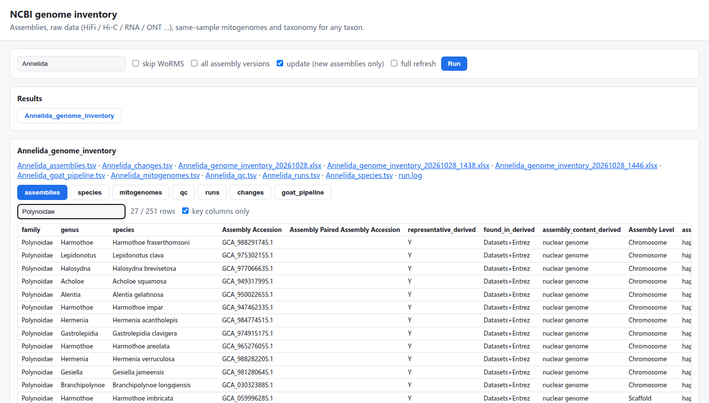

# ncbi-genome-inventory

**One command to inventory every NCBI whole-genome assembly of a taxon — with the raw data behind each
assembly, the mitogenome from the same sample, the taxonomy, and the species still being sequenced.**

[中文说明 (Chinese)](README.zh-CN.md)

Built for taxonomists and comparative genomicists who used to do this by hand: export the NCBI Datasets
table, look up every BioProject in SRA, guess which reads are HiFi or Hi-C, search for a mitogenome, match
names in WoRMS, and merge everything in Excel. All examples below are real output for **Annelida**
(run on 2026-10-28).



## Contents

- [Features](#features)
- [Installation](#installation)
- [Quick start](#quick-start)
- [Usage](#usage) — command line, web interface, updating
- [What each feature gives you (Annelida examples)](#what-each-feature-gives-you-annelida-examples)
- [Output files](#output-files)
- [How it works](#how-it-works)
- [Limitations](#limitations)
- [Testing](#testing) · [Acknowledgements](#acknowledgements)

## Features

| # | Feature | Question it answers |
|---|---|---|
| 1 | **Assembly table** with the same 41 columns as the NCBI Datasets web export | Which genomes exist for my taxon, and how good are they? |
| 2 | **Taxonomy**: NCBI lineage (phylum → species) + WoRMS accepted name | Where does each genome sit, is the name still valid? |
| 3 | **Raw data per assembly**: HiFi, CLR, ONT, Hi-C, short-read WGS, 10x, RNA-seq, Iso-Seq — run accessions and Gb | Which data were used to build this genome? |
| 4 | **Same individual?** for every linked run (ENA sample relations, ToLID) | Is the Hi-C / RNA-seq from the same animal as the assembly? |
| 5 | **One mitogenome per assembly, same sample first**; same-name substitutes are flagged | Which mitogenome belongs to this genome? |
| 6 | **Species being sequenced** (GoaT) that have no NCBI assembly yet, with project names | What is coming next for my taxon? |
| 7 | **Three sources cross-checked** (NCBI Datasets, Entrez, GoaT) + QC sheet | Is anything missing or inconsistent? |
| 8 | **Incremental update** + change report | What is new since last time? |
| 9 | **Local web interface** with search, filter and downloads | — |

Standard library only (Python ≥ 3.8): no pip install, no `datasets`, `edirect` or `kingfisher` needed.

## Installation

```bash
git clone https://github.com/deyuanyang92-dev/ncbi-genome-inventory.git
cd ncbi-genome-inventory
python3 genome_inventory.py --help
```

Optional, about 3× faster NCBI queries:

```bash
export NCBI_API_KEY=your_key        # https://www.ncbi.nlm.nih.gov/account/settings/
export NCBI_EMAIL=you@example.org
```

## Quick start

```bash
python3 genome_inventory.py Annelida -o Annelida_genome_inventory
```

The log shows each step; this is the end of a real Annelida run:

```text
[13:46:05] DONE
  assemblies (rows): 251
  species/taxa: 163
  SRA runs of these taxa: 7391
  runs linked to an assembly: 3148
  mitochondrial records: 240
  QC items: 145
  GoaT species in pipeline without NCBI assembly: 368
  assemblies with linked data type: HiFi 153, CLR 8, PacBio_unknown 1, ONT 19, Hi-C 169, short_read_WGS 92, 10x_linked 17, RNA-seq 120, Iso-Seq 3, Other 3
  mitogenome per assembly: same sample: in assembly 107; same sample: same BioSample 65; SUBSTITUTE ... 44; none 35
  linked run-assembly pairs by individual: same individual 3148; different individual 176; unknown 156
  -> Annelida_genome_inventory/Annelida_genome_inventory_20261028.xlsx
```

Open the `.xlsx` file; each sheet is described in [Output files](#output-files).

Time (no API key, measured): a family such as Polynoidae (27 assemblies) ≈ 5 min on the first run; a phylum
such as Annelida takes tens of minutes the first time. Re-running from the cache takes ≈ 2 s, and `--update`
takes ≈ 15–30 s when NCBI has nothing new.

## Usage

### Command line

```bash
python3 genome_inventory.py TAXON [options]
```

| Option | Meaning |
|---|---|
| `TAXON` | taxon name (`Annelida`, `Polynoidae`, `Platynereis`) or NCBI taxid (`6340`) |
| `-o, --out DIR` | output folder (default `<TAXON>_genome_inventory`) |
| `--taxid ID` | use this taxid when the name is ambiguous (the tool lists the candidates) |
| `--update` | check NCBI and GoaT for new assemblies; fetch raw data, mitogenomes and taxonomy only for new species/samples |
| `--refresh` | ignore the cache and refetch everything |
| `--all-versions` | also list superseded assembly versions (default: current versions only) |
| `--no-worms` | skip WoRMS name matching |
| `--no-goat` | skip GoaT (cross-check and species being sequenced) |
| `--email`, `--api-key` | NCBI identity (otherwise `$NCBI_EMAIL`, `$NCBI_API_KEY`) |

```bash
python3 genome_inventory.py Polynoidae                          # one family
python3 genome_inventory.py 6340 -o Annelida_out                # by taxid
python3 genome_inventory.py Annelida -o Annelida_out --update   # later updates
```

If a step fails (network), run the same command again: finished steps are read from `<out>/raw/`.

### Web interface

```bash
python3 webapp.py --data-dir genome_inventory_results       # then open http://127.0.0.1:8765
```

1. Type a taxon, tick **update** if results already exist, press **Run** — the log appears live.
2. When it finishes (or for any existing result folder) the tables open as tabs: assemblies, species,
   mitogenomes, qc, runs, changes, goat_pipeline.
3. Type in the filter box (a family, `SUBSTITUTE`, `different individual` …), click a header to sort, untick
   *key columns only* to see every column. Substitute mitogenomes are shown in orange.
4. Download links for the Excel and TSV files are above the tabs.

The page runs the same `genome_inventory.py`, so CLI and web results are identical. It listens on 127.0.0.1
only and checks the Host header, the Origin and a per-launch token.

### Updating

Re-run with `--update` (or tick *update* in the web page). The **Changes** sheet lists what differs from the
previous run in the same folder. Close the Excel file first; otherwise the new workbook is saved as
`..._HHMM.xlsx`.

## What each feature gives you (Annelida examples)

### 1. Assembly table — same columns as the NCBI web export

The first 41 columns of the **Assemblies** sheet have the same names and order as the table exported from the
NCBI Datasets website (`Assembly Accession` … `CheckM contamination`), so old spreadsheets and scripts keep
working. Every assembly is kept, including several assemblies of one species and alternate haplotypes.

| Assembly Accession | Organism Name | Level | Release | Size (bp) | Contig N50 | Scaffold N50 | Sequencing Tech | Submitter |
|---|---|---|---|---|---|---|---|---|
| GCA_949317995.1 | Acholoe squamosa | Chromosome | 2023-04-04 | 1,481,470,071 | 5,523,906 | 84,155,211 | PacBio,Arima2 | Wellcome Sanger Institute |
| GCA_965276055.1 | Harmothoe areolata | Chromosome | 2025-05-02 | 1,663,694,339 | 20,708,742 | 88,728,759 | PacBio,Arima | Genoscope |
| GCA_026936325.1 | Platynereis dumerilii | Scaffold | 2022-12-16 | 1,469,601,079 | 4,288,053 | 54,798,709 | PacBio RSII; Illumina HiSeq | The Platynereis Community |

Added columns include `representative_derived` (one flagged assembly per species: nuclear > primary >
RefSeq reference > level > contig N50 > newest), `assembly_content_derived` (7 Annelida "Complete Genome"
assemblies are in fact a single ~16 kb mitogenome) and `found_in_derived` (which sources list it).

### 2. Taxonomy — NCBI and WoRMS side by side

| Assembly | NCBI family | NCBI species | WoRMS accepted name | WoRMS status |
|---|---|---|---|---|
| GCA_949317995.1 | Polynoidae | Acholoe squamosa | Acholoe squamosa (AphiaID 146474) | accepted |
| GCA_963942565.1 | Magelonidae | Maea johnstoni | Magelona johnstoni (AphiaID 130269) | superseded combination |

Name conflicts like the second row are listed in QC; NCBI values are never changed.

### 3. Raw data behind each assembly

For each data type the Assemblies sheet gives `<type>_runs`, `<type>_Gb` and `<type>_accessions`, plus the
summary `data_types_derived`:

| Assembly | Species | data_types_derived | HiFi | Hi-C | RNA-seq | Linked by |
|---|---|---|---|---|---|---|
| GCA_949317995.1 | Acholoe squamosa | HiFi+Hi-C | 2 runs, 55.6 Gb (ERR10841326; ERR10841327) | 1 run, 229.2 Gb (ERR10851523) | — | sibling_project |
| GCA_982089195.1 | Melinna palmata | HiFi+Hi-C+RNA-seq | 3 runs, 127.7 Gb | 1 run, 146.5 Gb | 1 run, 16.8 Gb | sibling_project |
| GCA_033239005.1 | Lamellibrachia satsuma | ONT+short_read_WGS+RNA-seq | — | — | 9 runs, 30.8 Gb | bioproject; biosample |

Every run is classified in the **Runs** sheet, with the rule and a confidence:

| Run | Species | Instrument | Library protocol | Category | Confidence | Rule |
|---|---|---|---|---|---|---|
| ERR10841326 | Acholoe squamosa | Sequel II | PacBio - HiFi | HiFi | high | PacBio & keyword 'HiFi' |
| ERR10851523 | Acholoe squamosa | NovaSeq 6000 | Hi-C - Arima v2 | Hi-C | high | LibraryStrategy=Hi-C |
| ERR12876326 | Carpetania matritensis | PacBio RS II | — | CLR | medium | pre-HiFi instrument |
| ERR13433269 | Alentia gelatinosa | Sequel IIe | — | HiFi | low | Sequel IIe, no keyword (inferred) |

Annelida: Hi-C is linked to 169 assemblies, HiFi to 153, RNA-seq to 120, ONT to 19.

### 4. Same individual?

A run linked through the project is not necessarily from the sequenced animal; `individual_derived` checks it:

| Run | Type | Species | individual_derived |
|---|---|---|---|
| ERR10841326 | HiFi | Acholoe squamosa | same individual: BioSample relation (derived from the assembly sample) |
| ERR10851523 | Hi-C | Acholoe squamosa | same individual: BioSample relation |
| ERR16650963 | HiFi | Melinna palmata | different individual: ToLID wtMelPalm9 vs wtMelPalm2 |
| ERR16650975 | Hi-C | Melinna palmata | different individual: ToLID wtMelPalm1 vs wtMelPalm2 |

Assemblies get `same_individual_types_derived` and `other_individual_types_derived`; for *Acholoe* both HiFi
and Hi-C come from the reference animal. Annelida: 3,148 run–assembly pairs from the same individual, 176 from
a different one, 156 unknown.

### 5. One mitogenome per assembly, same sample first

| Assembly | Species | mito_accession | Length (bp) | mito_source_derived | Note |
|---|---|---|---|---|---|
| GCA_949317995.1 | Acholoe squamosa | OX439053.1 | 15,641 | same sample: in assembly | |
| GCA_949316145.1 | Acholoe squamosa (alternate) | OX439053.1 | 15,641 | same sample: same BioSample | |
| GCA_965119645.1 | Owenia fusiformis | OZ221967.1 | 18,801 | same sample: in assembly | mitogenome-only assembly, labelled "Chromosome" by NCBI |
| GCA_965276055.1 | Harmothoe areolata | CBDHZN010000007.1 | 77,074 | same sample: in assembly | > 30 kb: possibly concatenated copies, verify |
| GCA_059996285.1 | Harmothoe imbricata | MK858187.1 | 15,694 | **SUBSTITUTE: same species name, different sample** | 2 same-name records from 2 samples; identity not verified |

A same-name record is used only when no same-sample record exists; it is flagged and listed in QC, because
NCBI identifications are not checked. The INSDC original is preferred over its RefSeq `NC_` copy. Annelida:
107 assemblies with the mitogenome inside, 65 same BioSample, 44 substitutes, 35 none.

### 6. Species being sequenced (GoaT)

The **GoaT_pipeline** sheet lists species that [GoaT](https://goat.genomehubs.org) reports as in progress but
that have no NCBI assembly yet — 368 Annelida species. Nereididae, for example:

| Species | goat_sequencing_status | goat_projects |
|---|---|---|
| Hediste diversicolor | in_assembly | ATLASEA; DTOL |
| Nereis pelagica | in_assembly | ATLASEA; DTOL |
| Alitta succinea | data_generation | ATLASEA; CANBP; DTOL |
| Perinereis cultrifera | data_generation | ATLASEA; DTOL |
| Hediste sinesimplex | in_progress | ATLASEA |
| Neanthes rubicunda | sample_acquired | ATLASEA |

GoaT status, earliest to latest: `sample_collected` → `sample_acquired` → `data_generation` → `in_assembly`
→ `insdc_open` (assembly public) → `published`; `in_progress` means reported as ongoing without a stage.
Species that already have an assembly show their GoaT status in the **Species** sheet
(`goat_sequencing_status`).

The same question can be asked to GoaT directly in a browser:

```text
https://goat.genomehubs.org/search?query=tax_tree(Annelida)%20AND%20tax_rank(species)%20AND%20sequencing_status&result=taxon&fields=sequencing_status,long_list
```

Replace `Annelida` with any taxon; write `sequencing_status=in_assembly` to see one stage only.

### 7. Cross-checks and QC

Assembly lists from NCBI Datasets, Entrez `assembly` and GoaT are compared (Annelida: 252 in Datasets, 252 in
Entrez, GoaT's 250 all included). Examples from the **QC** sheet:

| Scope | ID | Name | Message |
|---|---|---|---|
| mitogenome | GCA_059746215.1 | Tubifex tubifex | no mitogenome from the assembly's own sample; same-name substitute MW690579.1 |
| assembly | GCA_043381215.1 | Platynereis dumerilii | sequencing_tech 'PacBio' declares PacBio but no linked PacBio run |
| assembly | GCA_965119645.1 | Owenia fusiformis | mitogenome-only (< 1 Mb): not a nuclear genome |
| worms | 1872991 | Maea johnstoni | WoRMS status 'superseded combination' → accepted name Magelona johnstoni |

### 8. Change report

After `--update`, the **Changes** sheet has rows such as `new assembly`, `no longer listed`, or
`field changed | Assembly Level | Scaffold → Chromosome`; when nothing changed it says so.

## Output files

`<out>/<Taxon>_genome_inventory_<YYYYMMDD>.xlsx` plus the same tables as `.tsv`:

| Sheet | One row per | Main columns |
|---|---|---|
| Assemblies | assembly (GCA; paired GCF in `Assembly Paired Assembly Accession`) | 41 NCBI columns, taxonomy, data types and run accessions, same-individual types, mitogenome |
| Species | species (taxid) | representative assembly, all assemblies, data types, mitogenome, GoaT status |
| Runs | SRA run of these species | RunInfo, library protocol, category + rule + confidence, linked assemblies, individual |
| Mitogenomes | nuccore mitochondrial record | length, topology, BioSample, relation to assemblies |
| QC | issue | scope, ID, name, message |
| Changes | difference from the previous run | change, assembly, field, old, new |
| GoaT_pipeline | species being sequenced without an NCBI assembly | class, order, family, status, projects |
| Query | — | parameters, rules, counts |

Columns ending in `_derived` are computed by this tool, each with a documented rule; all other values are
copied from NCBI unchanged. The `.xlsx` stores text as text; in the `.tsv` files, text starting with
`= + - @` gets a leading `'` so spreadsheets cannot run it as a formula.

## How it works

| Step | Source |
|---|---|
| Assembly list and metadata | NCBI Datasets v2 (NCBI moved the retired Assembly/Genome websites to Datasets in June 2024); cross-checked with Entrez `assembly` and GoaT |
| Sequences inside each assembly | NCBI FTP `*_assembly_report.txt` (all sequence names in one request); Datasets `sequence_reports` as fallback |
| Raw data | SRA RunInfo + SRA XML (title, design, library protocol) |
| Same individual | ENA `related_sample_accession` (`derived_from`, `same_as`, `has_part`) and the `tolid` sample attribute |
| Mitogenome records | nuccore by species (10–100 kb) and by BioSample (any length) |
| Taxonomy | NCBI Taxonomy; WoRMS `AphiaRecordsByMatchNames` |
| Species being sequenced | GoaT API (`sequencing_status`, `long_list`) |

**Linking runs to an assembly** (only runs of the same species or a subspecies): `biosample` (same BioSample)
> `bioproject` (same project, or parent/child) > `sibling_project` (both projects share a direct parent —
how Sanger/DToL/ERGA submit: *Acholoe squamosa* reads are in PRJEB59385 under the umbrella PRJEB59386, the
assembly in PRJEB60118). Runs of the species without such a link are counted only in the Species sheet.

**Data types** (first match wins; keywords from experiment title, design, library name and protocol):

| Category | Rule |
|---|---|
| Hi-C | LibraryStrategy = Hi-C, or Hi-C / Omni-C / Arima / Dovetail / proximity-ligation keyword (not RNA) |
| HiFi | PacBio + HiFi/CCS keyword; Revio/Vega; Sequel IIe without keyword (low confidence) |
| CLR | PacBio + CLR/subread keyword; RS / RS II / Sequel (medium confidence) |
| PacBio_unknown | Sequel II without keyword (listed in QC) |
| ONT / ONT_RNA | Oxford Nanopore genomic / transcriptomic |
| Iso-Seq / RNA-seq | PacBio transcriptomic / short-read transcriptomic |
| short_read_WGS | WGS on Illumina, BGI, DNBSEQ … |
| 10x_linked | 10x / Chromium / linked-read / stLFR / TELL-seq keyword |
| Other | metagenomic, amplicon, RAD-seq … |

**Mitogenome priority**: in the assembly (sequence labelled mitochondrion, or named mito/MT/chrM) > record
with the assembly's BioSample > record with the BioSample of linked raw data > same species name
(SUBSTITUTE). Within a level: INSDC original > complete > circular > ≥ 10 kb > newest.

## Limitations

- **Unpublished raw data cannot be linked.** 33 of 195 Annelida primary assemblies have no public reads
  (e.g. *Platynereis dumerilii*, early Sanger-read genomes, 2026 releases not yet in SRA or ENA); QC lists them.
- **Unlabelled mitogenomes are not detected.** A mitochondrial contig with a generic name inside an assembly
  needs sequence screening (e.g. BLAST), which this tool does not do.
- **Substitute mitogenomes are not identity-checked**; verify them (e.g. COI against the assembly) before use.
- **GoaT status is self-reported** by sequencing projects and may lag; "in progress" does not guarantee a release.
- Data-type rules depend on submitter text; uncertain calls carry `low` confidence or `PacBio_unknown`.

## Testing

```bash
python3 -m pytest -q tests        # offline, uses trimmed real NCBI responses
```

## Acknowledgements

Data from NCBI (Datasets, E-utilities, FTP), ENA, GoaT / genomehubs and WoRMS. `ncbi.py` and `xlsx.py` are
adapted from [yzz_taxonomy_workflow](https://github.com/deyuanyang92-dev/yzz_taxonomy_workflow)
(`modules/sra`), whose `sra` module inventories all SRA runs of a taxon. First developed in
[Temp_scripts](https://github.com/deyuanyang92-dev/Temp_scripts); this repository is the maintained home.

Related tools: [GoaT](https://goat.genomehubs.org), NCBI `datasets`, ncbi-genome-download, genome_updater,
kingfisher, pysradb, ffq. None of them links assemblies to their raw data, individuals and same-sample
mitogenomes for a whole taxon.

## License

No license has been chosen yet.
